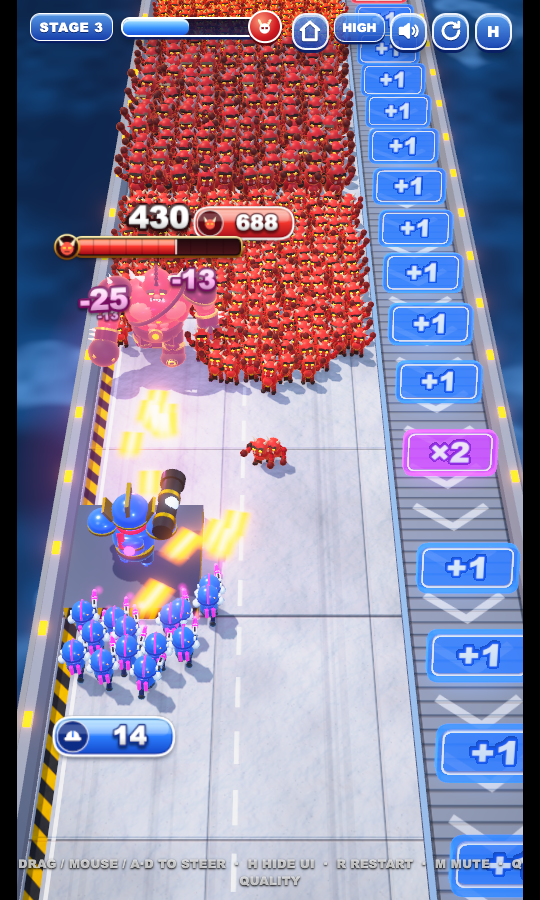

# Bridge Squad: levels kit

This kit turns [Bridge Squad](https://noclipepe.pages.dev/bridge/), the one-level browser game by [@noclipepe](https://x.com/noclipepe), into a game with **any number of levels**. It also adds **weapons**, **gate types** and **enemy types**.



This repo does **not** contain the game itself. `setup.sh` downloads the original from noclipepe's site and patches it on your machine.

```sh
./setup.sh                      # download the original game and build index.html
python3 -m http.server 8731     # then open http://127.0.0.1:8731/?level=1
```

## What the kit adds

| | |
|---|---|
| **Levels** | Hand-made levels live in `levels.js`. Every level number after them is **generated** from a seed, so `?level=57` is the same level for everyone. A win leads to **NEXT STAGE**, with no end. |
| **Weapons** | `rifle` (start), `laser` (the original ATK+150% crate), `rapid`, `spread`, `rocket` (splash damage), `rail` (pierces long lines). The cage crate gives one, and weapon gates give others. |
| **Gates** | `+N` (blue under 10, gold for 10+), `×N` multiplier (purple), `−N` trap (red, steer off the belt to dodge it), and weapon gates (green). |
| **Enemies** | `grunt` (stock), `brute` (big and tanky; survives several melee trades), `runner` (fast; charges from farther away). |

## How the original works

The game is one HTML page plus `three.min.js`. The game script is stored as text in `<script type="text/plain" id="main">` and runs once three.js has loaded. It uses no image or sound files: every mesh, texture and sound is generated in code.

The original has a single level, written directly into `reset()` and `update()`. `build.py` applies 45 exact-match patches to read the level from data and to add the new mechanics. If the original page changes and an anchor no longer matches, the build fails instead of producing a broken game.

## Level format (`levels.js`)

```js
{
  name: 'STAGE 4',
  gates: [                                       // conveyor timeline; t = second the gate reaches the squad
    { t: 2.0, every: 0.4, count: 20, val: 1 },   // 20 "+1" gates, one every 0.4 s
    { t: 10.2, op: 'x', val: 2 },                // ×2 multiplier
    { t: 12.0, op: '-', val: 8 },                // −8 trap
    { t: 15.0, weapon: 'rocket' },               // weapon gate
    { t: 23.0, every: 1.1, count: 3, val: 99 },  // gold +99s
  ],
  horde: [                                       // rectangles filled with a grid of enemies
    { x0: -6.05, x1: 2.85, d0: 17.5, d1: 40, gap: 0.62, type: 'grunt' },
    { x0: -6.05, x1: 2.85, d0: 40.6, d1: 62.6, gap: 0.9, type: 'brute', hp: 5 },
  ],
  cage: { x: -4.6, d: 16.2, hp: 30, weapon: 'laser' },   // shoot it open: frees the hero, drops this weapon
  bosses: [ { kind: 0, at: 12.6, ahead: 26 }, { kind: 1, at: 21, hp: 1500, cap: 9 } ],
  final: { hp: 9999, cap: 36, speed: 2.2, wakeAt: 29 },
  stars: [150, 300],                             // squad size needed for 2 and 3 stars
}
```

Any field you leave out takes the stock Stage 1 value. A broken level still loads, and the browser console says what is wrong with it.

**Testing levels**
- Try a level without editing files: `#lvl=<base64url JSON>`.
- Inspect any level from the console with `__bridgeLevel(n)`, including generated ones.

**Coordinates**
- x runs across the deck, from −6.6 to 6.6. The conveyor belt is at x = 4.95 ± 1.5.
- d is distance along the bridge. The squad moves at 1.2 d/s and stops at d = 55. The fortress is at d = 68.
- Gates move at 7 d/s, so a gate's `t` is the second it reaches the squad front.

## Numbers from the code

**Weapons**

| weapon | damage per shot | seconds between shots | notes |
|---|---|---|---|
| rifle | 1 | 0.34 | start weapon |
| laser | 2.5 | 0.34 | the original ATK crate |
| rapid | 1.2 | 0.15 | |
| spread | 3 × 1.0 | 0.40 | fans out against the horde, converges on bosses |
| rocket | 5 | 0.60 | splash radius 1.6 |
| rail | 7 | 0.80 | damage carries through enemies; range +8 |

Upgraded weapons all deal about 7.4–8.5 damage per second per soldier against a boss. They differ in how they deal with the horde. The hero fires every 0.25 s for 5 damage (12.5 once upgraded).

**Bosses**

| kind | default hp | smash cap | notes |
|---|---|---|---|
| 0 | 520 | 5 | |
| 1 | 1200 | 9 | |
| 2 | 9999 | 36 | final boss only; its leap slam wipes out the whole squad |

**Caps:** at most 480 soldiers, 1300 enemies, and 72 gates on screen (about 25 s of the timeline).

**Balancing rule of thumb:** an upgraded squad of N soldiers deals about 7.4 × N damage per second, and the final boss reaches the squad 4–6 s after it wakes. Keep `final.hp` at or below about 7.4 × expected squad × 4.

## The generator

`generateLevel(n)` in `build.py` builds each level from a seed.

**Difficulty ramp:** difficulty rises over the first 30 levels and then plateaus. Weapons unlock in this order:

| level | weapon unlocked |
|---|---|
| 3 | rapid |
| 4 | spread |
| 5 | rocket |
| 7 | rail |

**What a generated level contains**
- A stream of small gates. Some are swapped for ×2 gates, traps and one weapon gate.
- Gold gates as the boss wakes.
- 2–3 bands of horde.
- 1–3 mid-bosses.

**Boss and trap sizing:** the generator works out the squad size you should reach by taking every gate. The final boss's HP and the star thresholds come from that number. Each trap costs a share of the squad you should have at that moment.

## Play-testing

```sh
python3 -m http.server 8731 &
node playtest.mjs http://127.0.0.1:8731/ 1 2 3 10 50   # needs Playwright
```

A simple bot plays each level. It dodges traps, breaks the cage, grabs the crate, collects gates and tracks the boss. The last run:

| level | result | squad | weapon |
|---|---|---|---|
| 1 (stock) | win | 336 | laser |
| 2 | win | 228 | spread |
| 3 | win | 452 | rocket |
| 4 | win | 142 | spread |
| 7 | win | 224 | rapid |
| 10 | win | 189 | laser |
| 15 | win | 222 | laser |
| 25 | win | 184 | rail |
| 31 | win | 253 | rocket |
| 50 | win | 438 | rail |
| 100 | win | 336 | laser |

These are bot results; difficulty for a human player hasn't been tuned by hand.

## Credit

Bridge Squad, its art, code and design are by [@noclipepe](https://x.com/noclipepe). This repo contains only the patcher, the level data and the tooling.
