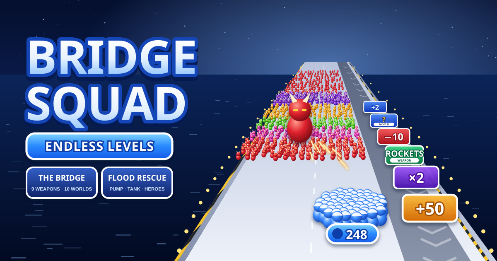
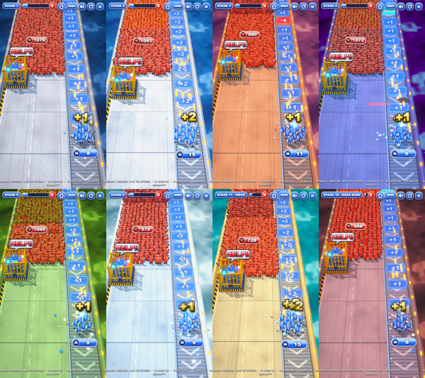
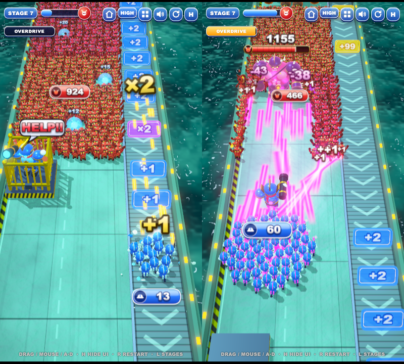
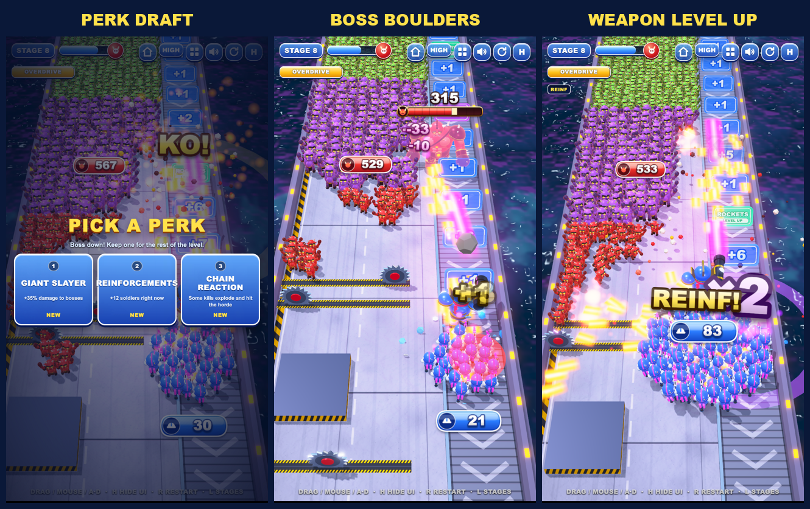
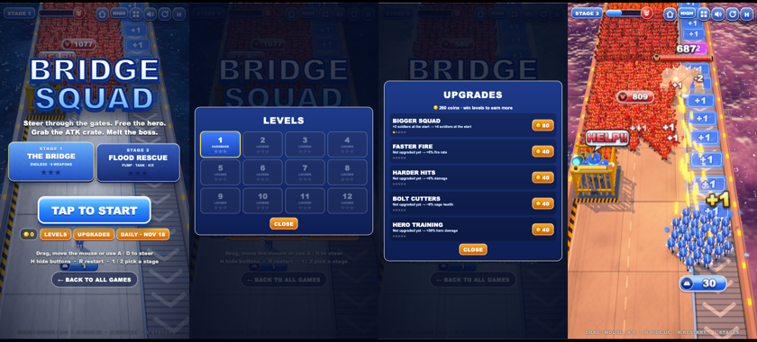
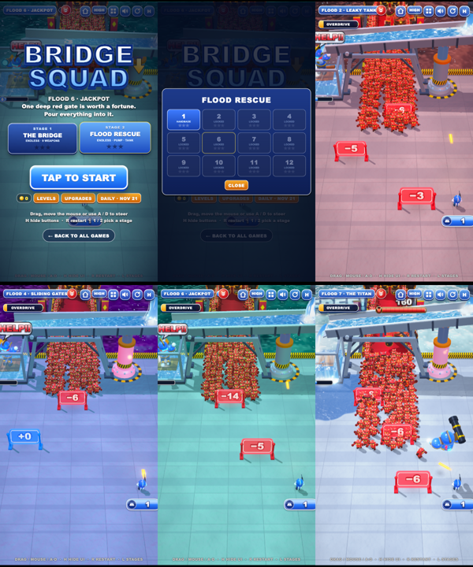
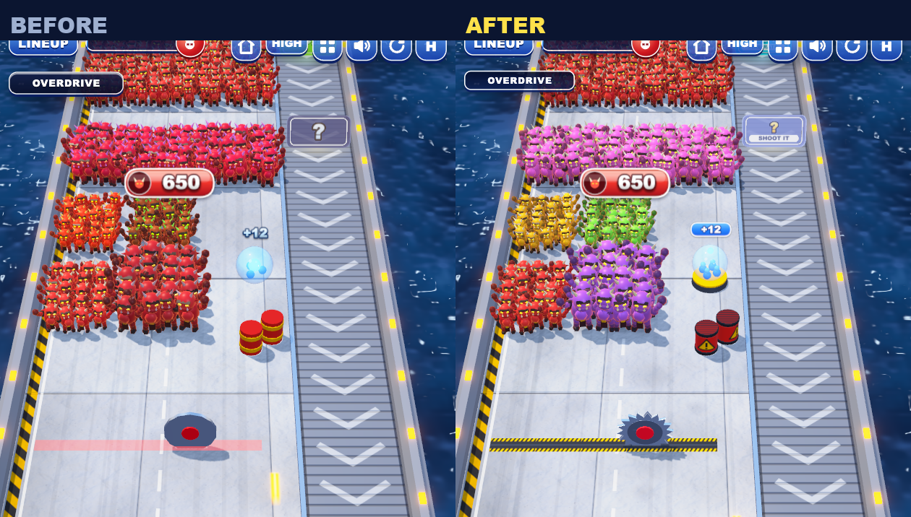
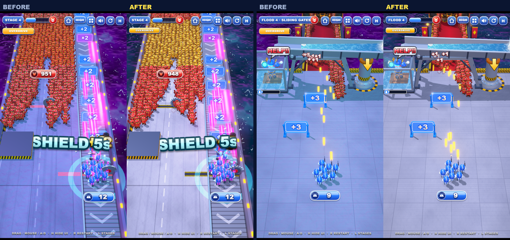

# Bridge Squad: levels kit



**Play it:** https://thedjpetersen.com/games/bridge-squad/

This kit turns [Bridge Squad](https://noclipepe.pages.dev/bridge/), the one-level browser game by [@noclipepe](https://x.com/noclipepe), into a game with **any number of levels**, in both of its modes. It also adds **weapons**, **gate types** and **enemy types**.



This repo does **not** contain the game itself. `setup.sh` downloads the original from noclipepe's site and patches it on your machine.

```sh
./setup.sh                      # download the original game and build index.html
python3 -m http.server 8731     # then open http://127.0.0.1:8731/?level=1
```

## What the kit adds

| | |
|---|---|
| **Levels** | Seven hand-made stages in `levels.js`. Every level number after them is **generated** from a seed, so `?level=57` is the same level for everyone. A win leads to **NEXT STAGE**, with no end. |
| **Level archetypes** | Generated levels draw from classic, SWARM (runners), SAWS (saw blades and a shield gate), ARSENAL (several weapon gates and frenzy), BOOM (barrels and bombers), SIEGE (brutes), BOSS RUSH (up to four mid-bosses) and FROST (freeze from the cage). |
| **Weapons** | `rifle`, `laser` (the original ATK+150%), `rapid`, `spread`, `rocket` (splash damage), `rail` (pierces), `flame` (short range, burns through crowds), `shock` (Tesla: chains to 3 more enemies), `freeze` (slows enemies and bosses). The cage crate gives one, and weapon gates give others. A gate for the gun you hold levels it up (see Run mechanics). |
| **Gates** | `+N` (blue, or gold for 10+), `×N` (purple), `−N` and `÷N` traps (red; steer off the belt), weapon gates (green), and teal buff gates: **FRENZY** (double fire rate for a few seconds), **SHIELD** (no melee, saw or mid-boss losses for a few seconds), fire rate and damage. Special gates carry a caption saying what they do. |
| **Enemies** | `grunt` (red), `brute` (violet; big and tanky, survives several melee trades), `runner` (amber; fast, aggros early), `bomber` (green; explodes when killed and takes extra soldiers with it in melee; chain reactions!) and `splitter` (magenta). Each type has its own body colour, so you can read a horde at a glance. |
| **Themes** | Ten original worlds: dusk (stock), day, sunset, neon, toxic, frost, desert, storm, aurora and dawn. Each world's look comes from its sky, fog and water; the deck and lights stay close to neutral, so every world still reads as the same bridge. Each archetype has a default, and any level can set `theme:`. |
| **Hazards** | **Saw blades** (toothed, in a hazard-striped slot) sweep across the belt or the deck at a fixed point. **Explosive barrels** (red drums with warning badges) sit in the horde: shoot one to blast everything around it. |

## Tracking the original

noclipepe's game changes over time. In November 2026 it gained a second stage, Flood Rescue, with a stage menu and reworked code. The kit drives the bridge stage (stage 1) and leaves Flood Rescue as it is; a win on the bridge moves on to the next kit level. When the original changes again, `setup.sh` fails and names the patch anchor that no longer matches, and the web page tells players and links to the original.

## Putting it on a website

`web/index.html` is a page that fetches the original game from noclipepe's site, applies `patches.json` in the browser and runs it. The original is never rehosted. If the original changes so the patches no longer fit, the page says so and links to it.

To deploy, run `./setup.sh` (which also writes `patches.json`). Then put `web/index.html` in a folder together with `patches.json`, `levels.js`, and `docs/cover.svg` and `docs/cover.jpg` (renamed to `cover.svg` and `cover.jpg`). `art/cover.py` regenerates the cover art.

## Progression and genre features

These were chosen by benchmarking the kit against this genre's video ads and gate shooters (Last War's "math shooter" ads, Weapon Rush, Gate Militia, Mob Control):

| Feature | How it works |
|---|---|
| **Shootable gates** | Gates with `shoot: true` count up as your squad shoots them: every `step` damage adds 1, up to `cap`. A red `−6` trap can be shot up into a blue `+3` before you reach it. Generated levels make traps shootable from level 4, and some `+` gates from level 6. |
| **Stat gates** | `{ buff: 'rate' }` gives +25% fire rate and `{ buff: 'dmg' }` gives +25% damage. Both stack for the rest of the level. |
| **Coins and upgrades** | Wins pay 10 + 10 per star + kills / 40 coins; losses pay kills / 60. Five upgrade tracks of five tiers each: bigger starting squad, faster fire, harder hits, a weaker cage and hero damage. |
| **Progress** | The menu opens at your furthest level. **LEVELS** shows a grid of every unlocked level with your best stars. |
| **Daily** | One generated level per date, the same for everyone (`?daily=1`), paying 40 extra coins. |
| **Share** | The end screen's **SHARE** uses the system share sheet, or copies a link with your stars. |

Progress is kept in the browser's `localStorage` under `bridge-squad-kit-v1`.

### Mechanics of our own

These go beyond the genre's staples:

| Mechanic | How it works |
|---|---|
| **Mystery `?` gates** | `{ mystery: true }` hides one of ×2, +20, +30, ÷2, −15, a shield, frenzy, rockets, a railgun or +25% damage, rolled each run. `inside:` fixes it instead. Shoot the gate for `step` damage (20 by default) to reveal it before you arrive, or run through blind. |
| **Prisoner pods** | Hazard `{ type: 'pod', x, d, hp, n }`: a glass pod inside the horde. Shoot it open and its `n` soldiers sprint over to join you, which is a reason to steer into danger. |
| **Splitters** | Enemy type `splitter` (purple, 3 hp): bursts into two grunts when killed. |
| **Overdrive** | Kills fill a meter. Once it's full, tap **OVERDRIVE** (or press F or Space) for 4 s of double fire rate, +50% damage and a shield. It adds a timing decision to an auto-shooter. |



Generated levels add two archetypes for these. **GAMBLE** (from level 7, theme `aurora`) has 3–4 `?` gates. **RESCUE** (from level 6, theme `dawn`) has 4–6 pods. Single `?` gates, pods and splitters also turn up in other levels.

### Run mechanics

Three mechanics make a level more than a DPS check: a choice after each mid-boss, a reason to steer during the boss fights, and a reason to take the same gun twice.

| Mechanic | How it works |
|---|---|
| **Perk draft** | When a mid-boss goes down, the game pauses on three cards. Tap one (or press 1, 2 or 3) to keep it for the rest of the level, up to three a level. Perks: CRITICAL HITS (+15% chance of triple damage), GIANT SLAYER (+35% boss damage), QUICK HANDS (+20% fire rate), FIELD MEDIC (a soldier every 2 s), REINFORCEMENTS (+12 now), IRON SKIN (1 in 3 hits miss), OVERCHARGE (overdrive charges twice as fast), CHAIN REACTION (some kills explode), GATE BOOST (+ gates give 1 more), QUICK FEET (smaller boulder circles). Picking one again stacks it. Flood Rescue drafts after each mini-boss, with GATE BREAKER (red gates count up twice as fast) in place of the bridge-only perks. Held perks show as chips under the overdrive meter. |
| **Boss boulders** | On their way in, bosses lob boulders at the squad. A red circle marks each landing spot about a second ahead. Anything inside when it lands is crushed: up to a tenth of the squad (a seventh for the final boss), and the horde too. Steer out of the circle, or catch the horde under it. A shield blocks it. |
| **Weapon levels** | A weapon gate for the gun you already hold says **LEVEL UP**. LV2 does +35% damage; LV3 does +70% and fires 15% faster. Generated levels from 5 on sometimes put a level-up gate for the cage's gun after the cage. |






## Flood Rescue campaign

The original's second stage, **Flood Rescue**, shipped as one level. The kit makes it a campaign of its own with its own progress, stars and level grid (pick FLOOD RESCUE on the menu, then LEVELS). Seven flood levels are hand-made in `levels.js` as `window.FLOOD_LEVELS`. Every flood level after them is generated, and `?flood=N` links straight to one.

| | |
|---|---|
| **Leaky tank** | `leak:` drains the tank every second, so you have to keep going back to the pump. |
| **Sliding gates** | A gate with `vx:` slides from side to side while it rolls in. You chase it while you shoot it blue. |
| **Jackpot gate** | A gate that starts deep red (e.g. −14) with a high `max:` (e.g. 14). It costs a lot of fire and is worth a lot of soldiers. |
| **Mixed horde** | `mix: [['runner', 0.3]]` puts the kit's runners, brutes, bombers and splitters into the marching column. |
| **More bosses** | `minis:` lists any number of brutes, each with a time, size (`kind` 0 or 1) and hp. `boss: { hp, speed, wake }` sets the final boss. |
| **Overdrive and upgrades** | Overdrive works in flood levels too. BIGGER SQUAD, FASTER FIRE and HERO TRAINING carry over. Coins are earned in both modes. |

Generated flood levels draw from LEAKY TANK, STAMPEDE (runners, faster march), SLIDING GATES, BRUTE SQUAD (two brutes), JACKPOT, BOMBERS and THE TITAN (big tank, big boss). Each has its own theme and a line on the menu that says what's different.

```js
{ name: 'FLOOD 4 · SLIDING GATES', theme: 'neon', callout: 'SLIDING GATES!',
  gates: [{ t: 0, x: -2.4, val: -4, d: 10.2, max: 4 }, { t: 5, x: 2.6, val: -4, vx: -1.0 }, /* ... */],
  boss: { hp: 650 }, stars: [9, 16] }
```



## Art direction

Everything the kit adds follows the original game's look, so it doesn't read as a mod:

- **UI**: glossy blue gradients, white rims, a dark lip shadow and gold for "selected", the same as the original's buttons and stage cards.
- **Gates** sort into colour families: blue, gold and purple add soldiers; reds cost soldiers; green arms the squad; teal gives a buff; silver hides a `?`.
- **Hazards** reuse the bridge's own materials: yellow/black kerb stripes, red toy plastic, and glass like the gates and the tank.
- **Enemy types** repaint only the body of the stock enemy, so horns, eyes and boots stay the same across the horde.
- **Worlds** change sky, fog and water. The rim light is kept pale because, as a directional light, it lights the whole deck.





## How the original works

The game is one HTML page plus `three.min.js`. The game script is stored as text in `<script type="text/plain" id="main">` and runs once three.js has loaded. It uses no image or sound files: every mesh, texture and sound is generated in code.

The original has two stages, each written directly into code: the bridge in `reset()` and `update()`, Flood Rescue in `reset2()` and `step2()`. `build.py` applies 91 exact-match patches to read the level from data and to add the new mechanics. If the original page changes and an anchor no longer matches, the build fails instead of producing a broken game.

## Level format (`levels.js`)

```js
{
  name: 'STAGE 7',
  theme: 'neon',                                 // dusk, day, sunset, neon, toxic, frost, desert, storm
  gates: [                                       // conveyor timeline; t = second the gate reaches the squad
    { t: 2.0, every: 0.4, count: 20, val: 1 },   // 20 "+1" gates, one every 0.4 s
    { t: 10.2, op: 'x', val: 2 },                // ×2 multiplier
    { t: 12.0, op: '-', val: 8 },                // −8 trap
    { t: 15.0, weapon: 'rocket' },               // weapon gate
    { t: 16.0, op: '/', val: 2 },                // ÷2 trap
    { t: 17.0, buff: 'frenzy', secs: 6 },        // or buff: 'shield'
    { t: 23.0, every: 1.1, count: 3, val: 99 },  // gold +99s
  ],
  horde: [                                       // rectangles filled with a grid of enemies
    { x0: -6.05, x1: 2.85, d0: 17.5, d1: 40, gap: 0.62, type: 'grunt' },
    { x0: -6.05, x1: 2.85, d0: 40.6, d1: 62.6, gap: 0.9, type: 'brute', hp: 5 },
  ],
  cage: { x: -4.6, d: 16.2, hp: 30, weapon: 'laser' },   // shoot it open: frees the hero, drops this weapon
  hazards: [
    { type: 'saw', d: 11, x0: 1.5, x1: 6.2, speed: 1.6, phase: 0 },   // sweeps between x0 and x1 at distance d
    { type: 'barrel', x: -2, d: 21, hp: 4, radius: 3.2 },
  ],
  bosses: [ { kind: 0, at: 12.6, ahead: 26 }, { kind: 1, at: 21, hp: 1500, cap: 9 } ],
  final: { hp: 9999, cap: 36, speed: 2.2, wakeAt: 29 },
  stars: [150, 300],                             // squad size needed for 2 and 3 stars
}
```

Any field you leave out takes the stock Stage 1 value. A broken level still loads, and the browser console says what is wrong with it.

**Testing levels**
- Try a level without editing files: `#lvl=<base64url JSON>`.
- Inspect any level from the console with `__bridgeLevel(n)`, including generated ones.

**Coordinates**
- x runs across the deck, from −6.6 to 6.6. The conveyor belt is at x = 4.95 ± 1.5.
- d is distance along the bridge. The squad moves at 1.2 d/s and stops at d = 55. The fortress is at d = 68.
- Gates move at 7 d/s, so a gate's `t` is the second it reaches the squad front.

## Numbers from the code

**Weapons**

| weapon | damage per shot | seconds between shots | notes |
|---|---|---|---|
| rifle | 1 | 0.34 | start weapon |
| laser | 2.5 | 0.34 | the original ATK crate |
| rapid | 1.2 | 0.15 | |
| spread | 3 × 1.0 | 0.40 | fans out against the horde, converges on bosses |
| rocket | 5 | 0.60 | splash radius 1.6 |
| rail | 7 | 0.80 | damage carries through enemies; range +8 |
| flame | 2 × 1.2 | 0.30 | range 14; keeps full damage through a crowd. A horde weapon: the generator never hands it out last |
| shock | 2.8 | 0.40 | chains to 3 more enemies, losing 25% each hop |
| freeze | 1.6 | 0.34 | slows enemies to 35% for 2.5 s and bosses to 45% for 1.5 s; the generator never hands it out last |

Upgraded weapons all deal about 7.4–8.5 damage per second per soldier against a boss. They differ in how they deal with the horde. The hero fires every 0.25 s for 5 damage (12.5 once upgraded).

**Bosses**

| kind | default hp | smash cap | notes |
|---|---|---|---|
| 0 | 520 | 5 | |
| 1 | 1200 | 9 | |
| 2 | 9999 | 36 | final boss only; its leap slam wipes out the whole squad |

**Caps:** at most 480 soldiers, 1300 enemies, and 72 gates on screen (about 25 s of the timeline).

**Balancing rule of thumb:** an upgraded squad of N soldiers deals about 7.4 × N damage per second, and the final boss reaches the squad 4–6 s after it wakes. Keep `final.hp` at or below about 7.4 × expected squad × 4.

## The generator

`generateLevel(n)` in `build.py` builds each level from a seed.

**Difficulty ramp:** difficulty rises over the first 30 levels and then plateaus. Each level picks an archetype from those unlocked so far. Weapons unlock in this order:

| level | weapon unlocked |
|---|---|
| 3 | rapid |
| 4 | spread |
| 5 | rocket |
| 6 | flame |
| 7 | rail |
| 9 | shock |
| 11 | freeze |

**What a generated level contains**
- A stream of small gates. Some are swapped for ×2 gates, traps and one weapon gate.
- Gold gates as the boss wakes.
- 2–3 bands of horde.
- 1–3 mid-bosses.

**Boss and trap sizing:** the generator works out the squad size you should reach by taking every gate. The final boss's HP and the star thresholds come from that number. Each trap costs a share of the squad you should have at that moment.

## Play-testing

```sh
python3 -m http.server 8731 &
node playtest.mjs http://127.0.0.1:8731/ 1 2 3 10 50   # needs Playwright
```

A simple bot plays each level. It dodges traps and saws, breaks the cage, grabs the crate, collects gates and tracks the boss. The last runs all ended in a win:

| level | archetype | squad | weapon at the boss |
|---|---|---|---|
| 1 (stock) | classic | 336 | laser |
| 2 | spread gate, runners | 228 | spread |
| 3 | traps, brutes | 452 | rocket |
| 4 | saws, shield, tesla | 342 | shock |
| 5 | barrels, bombers, flamer | 342 | rocket |
| 6 | frost, boss rush, ÷2 | 268 | rail |
| 7 / 9 / 13 / 27 | ARSENAL | 473 / 433 / 310 / 252 | rocket / rocket / shock / spread |
| 8 / 14 / 60 | SWARM | 268 / 279 / 179 | laser / rocket / laser |
| 10 / 20 / 30 | BOSS RUSH | 266 / 139 / 214 | spread / rapid / spread |
| 11 / 23 / 77 | SIEGE | 358 / 191 / 210 | rocket / laser / shock |
| 16 | SAWS | 149 | spread |
| 18 / 100 | BOOM | 210 / 192 | rapid / rail |
| 33 | classic | 457 | rapid |
| 45 | FROST | 245 | spread |

A second bot plays Flood Rescue levels: it shoots gates blue and walks through them, pumps the tank, and fires overdrive at the boss.

```sh
node floodtest.mjs "http://127.0.0.1:8731/?flood=7"
```

It won every flood level it was given: hand-made 1–7, and generated 8, 9, 10, 13, 16, 18, 20, 25, 30, 50 and 100.

These are bot results; difficulty for a human player hasn't been tuned by hand.

## Credit

Bridge Squad, its art, code and design are by [@noclipepe](https://x.com/noclipepe). This repo contains only the patcher, the level data and the tooling.
